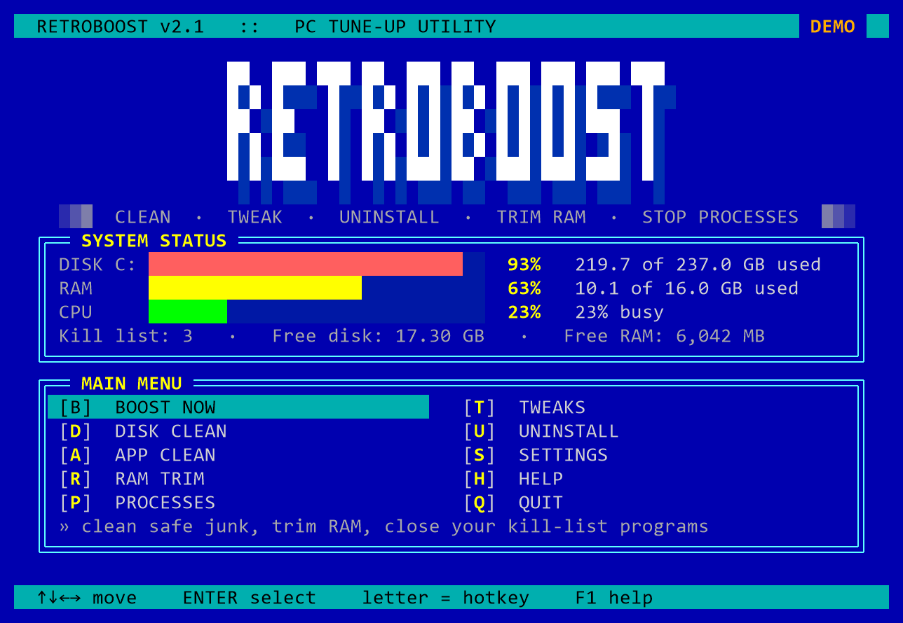
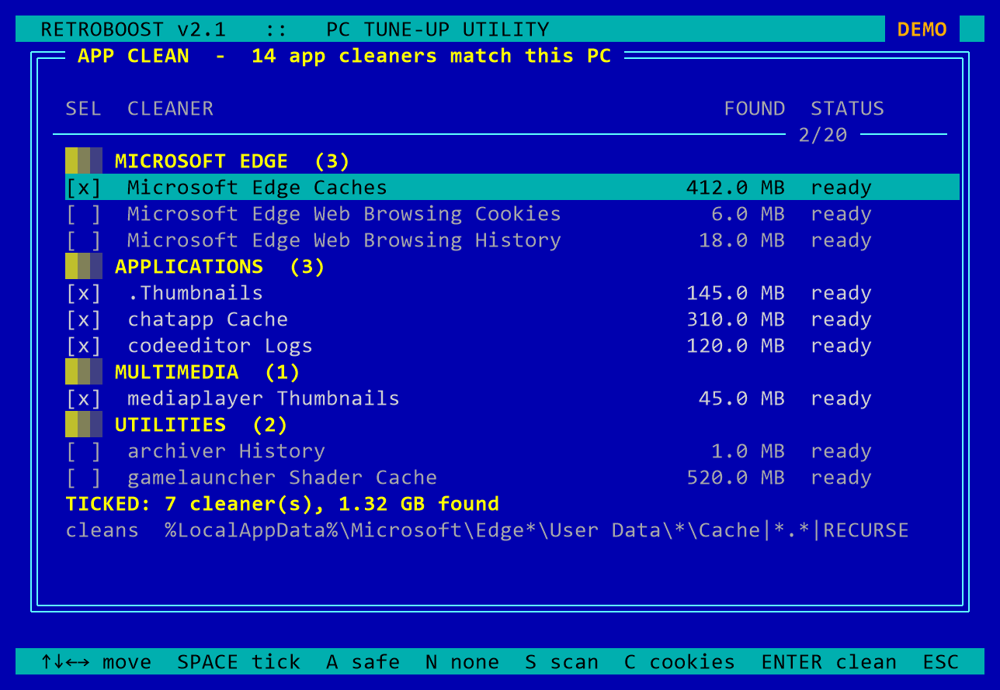
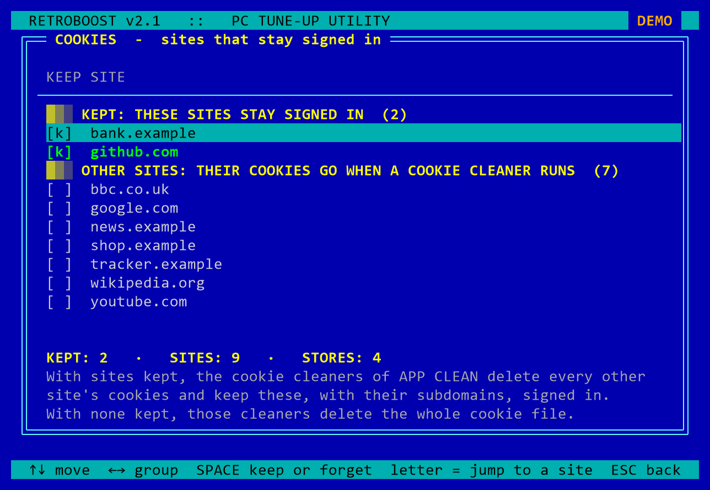
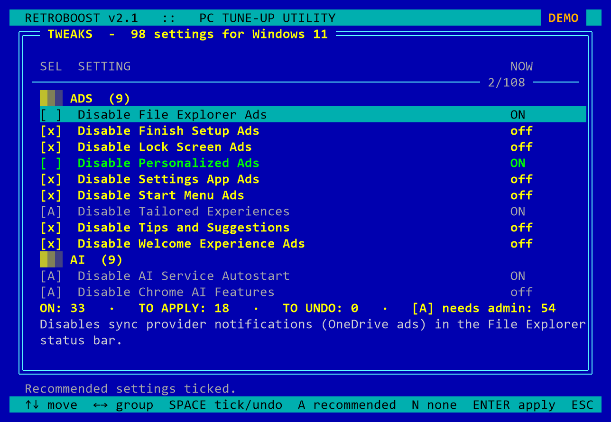
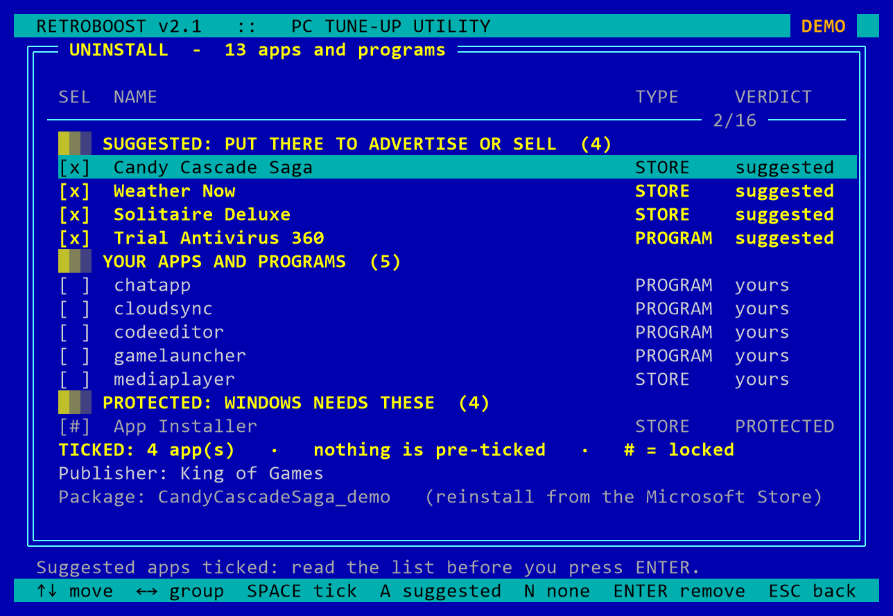
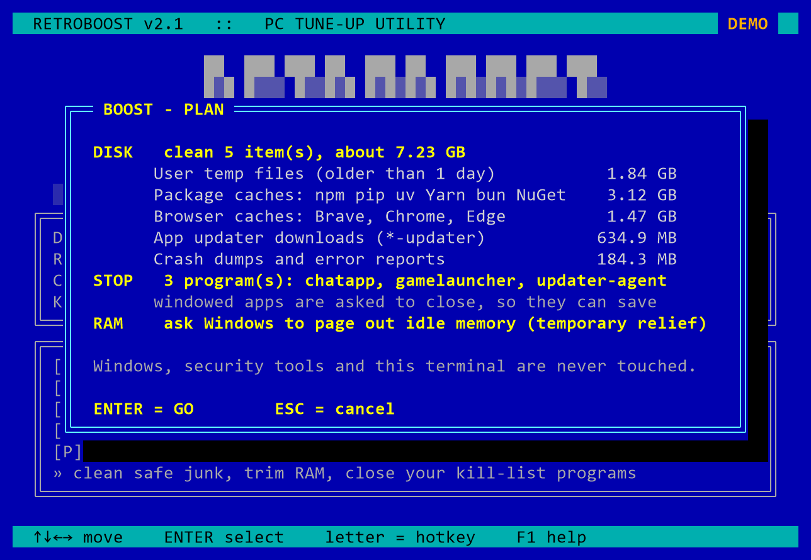
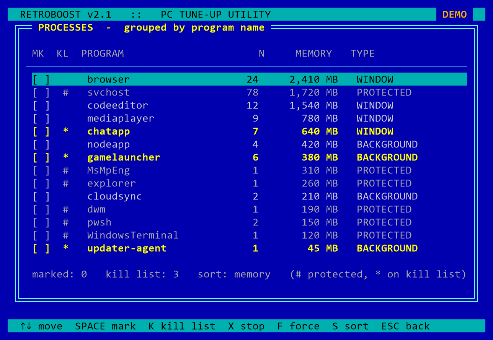
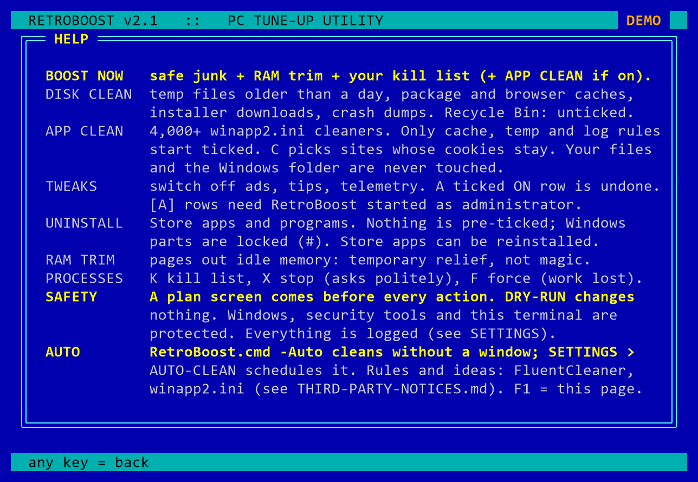
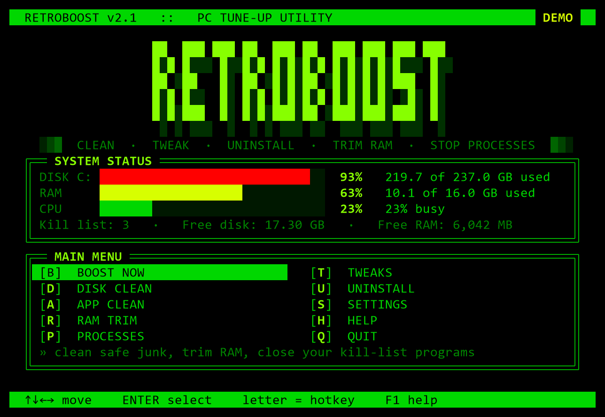
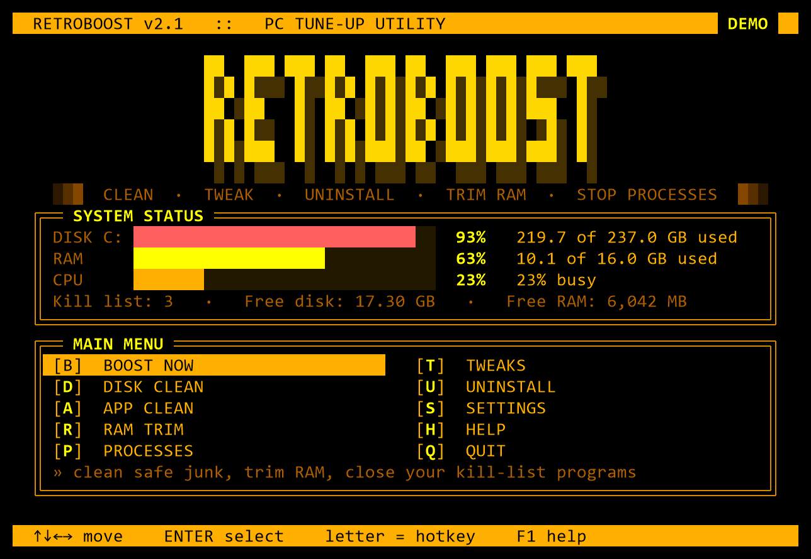

<div align="center">

# 🕹️ RetroBoost

### Free up your C: drive, clean 4,000+ apps, switch off Windows ads and remove bloatware: one retro text-mode tool.

A retro text-mode PC tune-up for Windows, written in PowerShell.<br>
**Free · open source · no install · no admin needed · no network · no telemetry**

[](LICENSE)
[](https://github.com/PowerShell/PowerShell)
[](#-quick-start)
[](https://github.com/DevDataAnalyst/RetroBoost/actions/workflows/ci.yml)
[](CONTRIBUTING.md)



<sub>Every screenshot in this README is rendered from the app's built-in <code>-Demo</code> mode (invented data, nothing from a real PC).</sub>

</div>

---

## Contents

[Why you'll want it](#-why-youll-want-it) ·
[New in 2.0](#-new-in-20-the-fluentcleaner-features) ·
[Free up your C: drive: the plan](#-free-up-your-c-drive-the-plan) ·
[Quick start](#-quick-start) ·
[Screenshots](#-screenshots) ·
[What BOOST does](#-what-boost-does) ·
[APP CLEAN, TWEAKS, UNINSTALL, AUTO](#-app-clean) ·
[Safety first](#-safety-first) ·
[Usage](#-usage) ·
[FAQ](#-faq) ·
[Contribute](#-contribute) ·
[Roadmap](#-roadmap) ·
[License](#-license)

## ✨ Why you'll want it

| | |
|---|---|
| 🧹 **Get gigabytes back, safely** | BOOST cleans only junk that Windows and your apps rebuild by themselves: temp files older than a day, package and browser caches, installer downloads, crash dumps. Documents, photos and downloads are never touched. |
| 🧽 **4,000+ app cleaners** | APP CLEAN brings the community **winapp2.ini** database, the one CCleaner made famous: browsers, Office, Adobe, chat apps, games, Windows traces. Only cache, temp and log rules start ticked; history, cookies and sessions are yours to tick. |
| 🍪 **Clear cookies, stay signed in** | The cookie keep-list: pick the sites you use (`C` on APP CLEAN) and the cookie cleaners delete every *other* site's cookies, in every browser winapp2 knows. |
| 🔕 **Switch off the nagging** | TWEAKS: 98 Windows settings (ads, tips, telemetry, AI extras, taskbar, Explorer) with a live ON/off column and one-key undo. |
| 🗑️ **Bloatware out** | UNINSTALL lists Store apps and programs, flags the ones put there to advertise or sell, and locks what Windows needs. Nothing is ever pre-ticked. |
| 🧠 **Stop RAM hogs on your terms** | Build a *kill list* of programs you don't want running. BOOST closes them politely so they can save. Windows, security tools and your terminal are protected and can't be added. |
| 🖱️ **One click, or two keys** | `RetroBoost-OneClick.cmd` shows a 3-second countdown (ESC cancels), then runs BOOST. Prefer control? Open the app, read the plan, press ENTER. |
| ⏰ **Set and forget** | SETTINGS → AUTO-CLEAN schedules a silent safe clean (daily, weekly or at logon). Nothing is stopped while you work. |
| 🔍 **Nothing hidden** | A plan screen before every action, a dry-run mode, a demo mode with invented data, and a log of everything it does. One readable script, no network calls, no telemetry. |
| 🪶 **Zero install, admin optional** | Download, double-click. It runs as you. Start it as administrator only if you want the `[A]` tweaks. |
| 🕹️ **A UI that sparks joy** | Blue-screen DOS look, BIOS boot splash, block-letter logo, three phosphor themes (blue, green, amber) and optional beeps. |
| 👩‍💻 **Developer friendly** | Clears npm, pip, uv, Yarn, bun and NuGet caches, VS Code leftovers and crash dumps: the things that quietly eat a small SSD. |

**Honest about the limits.** RAM trimming gives *temporary* relief, because Windows refills memory when programs ask for it; closing heavy programs is what frees RAM for real, and RetroBoost says so on screen. Windows' own junk (Update cache, previous installations, system logs) is best removed by Windows itself, so RetroBoost opens the right Settings page for you (`W` on the Disk screen) and never touches the Windows folder.

## 🆕 New in 2.0: the FluentCleaner features

RetroBoost 2.0 brings the ideas of [**FluentCleaner**](https://github.com/builtbybel/FluentCleaner), the transparent, community-powered CCleaner alternative, into the retro text UI. Its engines were ported to PowerShell and its rule files ship in [`data/`](data/) ([credits and licenses](THIRD-PARTY-NOTICES.md)).

| FluentCleaner | RetroBoost 2.0 | Notes |
|---|---|---|
| winapp2.ini cleaner (detect, analyze, clean) | **APP CLEAN** (`A`) | grouped like FluentCleaner, plus RetroBoost's guards: your folders, the Windows folder and fresh temp files are never touched |
| Running-browser warning | `[!] close Edge` rows | browser rules wait until that browser is closed |
| Locked-file skip, `ExcludeKey`, `REMOVESELF` | built in | sizes count only files that can really be deleted |
| Custom cleaners and global exclusions | `custom\*.ini` and `"exclude"` in `config.json` | same winapp2 syntax |
| Tweaks (WinRules.ini): check, apply, reset | **TWEAKS** (`T`) | values are read back after writing; `[A]` marks settings that need admin |
| Apps: Store apps and programs, AppRules.ini | **UNINSTALL** (`U`) | silent uninstall first, then the program's own window; Windows parts locked |
| `/AUTO`, `/AUTO /SHUTDOWN`, scheduler | `-Auto`, `-Auto -Shutdown`, SETTINGS → AUTO-CLEAN | the scheduled run never stops programs |
| Cookie Manager: keep chosen sites' cookies | **COOKIES** (`C` on APP CLEAN), **new in 2.1** | finds the cookie stores through winapp2's own rules, so it covers every browser winapp2 knows |
| AI explanations, winget uninstall step | left out | they need the network; RetroBoost makes no network calls |

## 🧭 Free up your C: drive: the plan

C: almost full? Work through this list from the top. The first steps give the most space for the least risk. The full guide, with the *why* and the warnings, is in **[docs/FREE-UP-C-DRIVE.md](docs/FREE-UP-C-DRIVE.md)**.

| # | Step | Time | Typical gain | How |
|---|------|------|--------------|-----|
| 1 | **Measure** | 1 min | n/a | Open RetroBoost (the disk gauge turns red above 85%) or *Settings → System → Storage* |
| 2 | **Clear the safe junk** | 2 min | 0.5–10 GB | RetroBoost → **BOOST NOW**, then **APP CLEAN** for your apps' caches |
| 3 | **Let Windows clean itself** | 5 min | 1–25 GB | RetroBoost → *DISK CLEAN* → **W** (opens *Settings → Storage → Temporary files*) |
| 4 | **Uninstall what you don't use** | 5 min | 2–50+ GB | RetroBoost → **UNINSTALL**, or *Settings → Apps → Installed apps* sorted by size |
| 5 | **Hunt big files** | 10 min | varies | File Explorer search `size:gigantic` inside Downloads, Videos, Desktop |
| 6 | **Move, don't delete** | 10 min | 5–100+ GB moved | OneDrive *Free up space*, game libraries and Downloads to another drive |
| 7 | **Keep it clean** | 2 min, once | prevents the next crunch | RetroBoost SETTINGS → **AUTO-CLEAN**, and *Storage Sense* |

Gains vary a lot from PC to PC; they are ranges, not promises. Developers get a bonus checklist (Docker, WSL, `node_modules`, SDKs) in the full guide.

## 🚀 Quick start

```text
1. Install PowerShell 7 (once):        winget install Microsoft.PowerShell
2. Download the latest release zip:    https://github.com/DevDataAnalyst/RetroBoost/releases/latest
   Right-click the zip → Properties → tick "Unblock" → Extract all
3. Double-click RetroBoost.cmd, press ENTER on BOOST NOW, press ENTER to confirm.
```

**Want a risk-free look first?** Open a terminal in the folder and run:

```text
RetroBoost.cmd -Demo
```

Demo mode uses invented data: nothing on your PC is read, changed or stopped.

**Prefer git?**

```text
git clone https://github.com/DevDataAnalyst/RetroBoost.git
cd RetroBoost
.\RetroBoost.cmd
```

### Requirements

- Windows 10 or 11
- [PowerShell 7+](https://github.com/PowerShell/PowerShell) (`pwsh`); Windows PowerShell 5.1 is not supported yet ([help wanted](docs/ROADMAP.md))
- A terminal window of at least **80×26** characters; [Windows Terminal](https://aka.ms/terminal) looks best

## 🖼️ Screenshots

<table>
  <tr>
    <td align="center"><br><sub><b>APP CLEAN</b>: 4,000+ winapp2 cleaners, only the safe ones pre-ticked</sub></td>
    <td align="center"><br><sub><b>COOKIES</b>: the sites that stay signed in</sub></td>
  </tr>
  <tr>
    <td align="center"><br><sub><b>TWEAKS</b>: see what is ON, tick, apply, undo</sub></td>
    <td align="center"><br><sub><b>UNINSTALL</b>: bloatware flagged, Windows parts locked (#)</sub></td>
  </tr>
  <tr>
    <td align="center"><br><sub><b>The plan screen</b>: nothing runs until you press ENTER</sub></td>
    <td align="center"><br><sub><b>The result</b>: before → after, and what was skipped and why</sub></td>
  </tr>
  <tr>
    <td align="center"><br><sub><b>DISK CLEAN</b>: tick what to delete, see the size first</sub></td>
    <td align="center"><br><sub><b>PROCESSES</b>: protected programs are locked (#), your kill list is starred (*)</sub></td>
  </tr>
  <tr>
    <td align="center"><br><sub><b>RAM TRIM</b>: see the biggest memory users</sub></td>
    <td align="center"><br><sub><b>HELP</b> (F1): every screen and the safety rules on one page</sub></td>
  </tr>
  <tr>
    <td align="center"><br><sub><b>Green phosphor</b> theme</sub></td>
    <td align="center"><br><sub><b>Amber phosphor</b> theme</sub></td>
  </tr>
</table>

### 📸 Real terminal captures: help wanted

The images above are painted from the app's own screen buffer by [`tools/Render-Screenshots.ps1`](tools/Render-Screenshots.ps1). We would love **real captures** from real terminals, fonts and themes. Drop a PNG into `docs/screenshots/` (see [how](docs/screenshots/README.md)) and send a pull request; your name goes in the credits.

| Windows Terminal | Classic console host | Your setup |
|:---:|:---:|:---:|
| <!-- add docs/screenshots/real-windows-terminal.png --> *your screenshot here* | <!-- add docs/screenshots/real-console-host.png --> *your screenshot here* | <!-- add docs/screenshots/real-yours.png --> *your screenshot here* |
| **Boot splash (animated)** | **One-click countdown** | **Demo mode tour (GIF)** |
| <!-- add docs/screenshots/boot-splash.gif --> *a short GIF would be perfect* | <!-- add docs/screenshots/one-click.png --> *your screenshot here* | <!-- add docs/screenshots/demo-tour.gif --> *your GIF here* |

## 🧰 What BOOST does

BOOST = **clean junk** + **trim RAM** + **close your kill-list programs**. The kill list starts **empty**, so a fresh install stops nothing until *you* add programs. Switch on SETTINGS → **BOOST+APP CLEAN** and BOOST also runs your APP CLEAN ticks.

| Category | Where (for your user account) | Rule |
|---|---|---|
| User temp files | `%TEMP%` | only files older than 1 day; the `claude` temp folder is skipped |
| Package caches | `%LOCALAPPDATA%\npm-cache`, `uv\cache`, `pip\cache`, `Yarn\Cache`, `NuGet\v3-cache`, `%USERPROFILE%\.bun\install\cache` | they regrow on demand |
| Browser caches | Brave, Chrome and Edge `User Data\*\Cache`, `Code Cache`, `GPUCache` | skipped while that browser is open; logins and history stay |
| Updater downloads | `%LOCALAPPDATA%\*-updater` | installer copies apps fetch again if needed |
| VS Code leftovers | `%APPDATA%\Code\CachedExtensionVSIXs`, hidden staging folders in `.vscode\extensions` | skipped while VS Code is open |
| Crash dumps and reports | `%LOCALAPPDATA%\CrashDumps`, `Microsoft\Windows\WER` | diagnostic leftovers |
| GPU shader caches | `D3DSCache`, `NVIDIA\DXCache`, `NVIDIA\GLCache`, `AMD\DxCache` | **unticked**: games rebuild them once |
| Recycle Bin | C: | **unticked**: emptying cannot be undone |

Details and the reasoning behind each rule: **[docs/SAFETY.md](docs/SAFETY.md)**.

## 🧽 APP CLEAN

The 4,076 rules of [winapp2.ini](https://github.com/MoscaDotTo/Winapp2) describe, app by app, which caches, logs and traces can go. RetroBoost reads them, keeps only the apps you have (often 150–300 rules), and groups them like FluentCleaner: Microsoft Edge, Applications, Internet, Multimedia, Utilities, Windows, Google Chrome, Firefox and more.

- **Ticked with care.** Only rules that winapp2 ticks by default **and** whose name says cache, temp, log, crash, dump, thumbnail or telemetry start ticked. History, cookies, saved sessions, passwords, recent-file lists and backups are listed but left to you. `A` returns to that safe set, `N` clears everything.
- **See before you clean.** `S` scans the ticked rules and shows what they would delete now; the bottom lines show exactly which paths and registry keys the selected rule names, and any winapp2 warning.
- **Guards that beat any rule.** Documents, Desktop, Downloads, Pictures, Music, Videos and OneDrive, the **whole Windows folder**, Store app installs, installer caches, temp files younger than a day and browser-extension databases (password managers) are never touched. Files in use are skipped, not fought, and are not counted. A browser rule waits (`[!] close Edge`) while that browser runs.
- **Your own rules.** Put winapp2-format `.ini` files in `%LOCALAPPDATA%\RetroBoost\custom\`: they are read after the built-in database, and a rule with the same name replaces the built-in one. Add exclusions to `config.json`, in winapp2 syntax: `"exclude": ["PATH|%LocalAppData%\\MyApp\\", "FILE|%AppData%\\Tool\\|settings.db"]`.

### 🍪 The cookie keep-list (new in 2.1)

Clearing cookies signs you out of everything. Press **`C`** on APP CLEAN to open **COOKIES**: every site that has cookies in your browsers, read from their cookie databases (site names only, never the cookies themselves). `SPACE` keeps a site, and a letter jumps to the sites that start with it.

With sites on the list, a browser's cookie cleaner (*Google Chrome Web Browsing Cookies* and the rest) **no longer deletes the cookie file**: it deletes every other site's cookies inside it and keeps the kept sites **and their subdomains** (`github.com` keeps `api.github.com`, not `notgithub.com`). It works for Chrome, Edge, Brave, Opera, Vivaldi, Arc, Firefox, Thunderbird and every other browser winapp2 has a cookie rule for, using the SQLite that ships with Windows. A cookie database that is busy (browser open) or can't be edited is left whole, never deleted instead. The plan screen warns when a cookie cleaner would sign you out of every site. The list lives in `config.json` (`"keepCookies"`).

## 🔕 TWEAKS

98 settings from FluentCleaner's catalogue, grouped by **Ads, AI, Appearance, Edge, Explorer, Gaming, Privacy, System, Taskbar and Updates**, filtered to your Windows version. The **NOW** column shows what your PC says today.

- `SPACE` ticks a setting that is off (`[x]`); on a setting that is ON it marks an **undo** (`[u]`), which writes back the Windows default the catalogue records. `A` ticks the recommended ones.
- Every value is **read back** after writing; a setting counts as done only if Windows kept it. Variants of one setting (a `Group`) can't be ticked together.
- `[A]` rows change every account on the PC (machine settings and policies): Windows only lets an administrator do that. Right-click `RetroBoost.cmd` → *Run as administrator* to unlock them.
- Some changes show after Explorer restarts: the result screen offers `X` to restart it.

## 🗑️ UNINSTALL

Store apps from your Start menu and the programs the Control Panel lists, in three groups: **suggested** (put there to advertise or sell, per `data/AppRules.ini`), **your apps and programs**, and **protected** (Windows parts, frameworks, drivers and runtimes, PowerShell and Windows Terminal).

- Nothing is pre-ticked. `A` ticks the suggested ones; read the list before ENTER.
- Store apps are removed for your account (reinstall them from the Microsoft Store any time). Programs are tried silently first (their quiet uninstaller, then `msiexec`), and only then is their own uninstaller window opened: finish it there. Each removal is checked against Windows' own list.

## ⏰ AUTO

- `RetroBoost.cmd -Auto` runs BOOST's safe cleaning without a screen (plus your APP CLEAN ticks if BOOST+APP CLEAN is on), logs it and exits. It never stops programs or trims RAM.
- `-Auto -Shutdown` shuts Windows down 60 seconds after the clean (`shutdown /a` cancels).
- SETTINGS → **AUTO-CLEAN** (`OFF`, `DAILY`, `WEEKLY`, `LOGON`) creates or removes a Task Scheduler task for your account, *RetroBoost AutoClean*: daily at 12:00, Mondays at 12:00, or at logon, run as soon as possible if the PC was off. No admin needed. Moved the RetroBoost folder? Set the schedule again.

## 🛡️ Safety first

RetroBoost deletes files, writes settings, uninstalls apps and stops programs, so it is built to be boring and predictable.

- **Plan before action.** BOOST, DISK CLEAN, APP CLEAN, TWEAKS, UNINSTALL and STOP all show what will happen and wait for ENTER. (You can turn the BOOST confirmation off in Settings if you want a true one-keypress BOOST.)
- **Guards that rules can't argue with.** Your personal folders and the Windows folder are off limits to every cleaner, whatever a rule file says.
- **Protected programs and apps.** Windows core processes, security tools, the terminal and anything it cannot read are locked (`#`) and can never be stopped; Windows parts can never be uninstalled.
- **Polite close first.** Programs with a window are asked to close so they can offer to save. `F` (force) is explicit and warns about unsaved work.
- **Undo where possible.** Tweaks can be put back; the plan screen says plainly when something (an uninstall, the Recycle Bin) can't be undone.
- **Dry-run and demo.** `-DryRun` changes nothing; `-Demo` doesn't even read your PC.
- **A log.** Everything it does is written to `%LOCALAPPDATA%\RetroBoost\boost.log`.
- **A self-test.** [`tests/selftest.ps1`](tests/selftest.ps1) builds a throwaway sandbox (fake caches, a fake app with its own winapp2 rules, a throwaway registry key, a fake "unwanted" program and a fake installed program) and proves that dry-run changes nothing, that the cleaners remove exactly the right files, that the guards hold, that a tweak is applied and undone, and that an uninstall is verified. CI runs it on every change.

> ⚠️ **Use at your own risk.** Deleted files do not go to the Recycle Bin, and RetroBoost cannot undo an uninstall. Try `-Demo` and `-DryRun` first and read the plan screen. See the [MIT license](LICENSE) (no warranty).

## ⌨️ Usage

```text
RetroBoost.cmd                    open the app
RetroBoost.cmd -Boost             open straight on the BOOST plan
RetroBoost-OneClick.cmd           one click: 3-second countdown (ESC cancels), then BOOST
RetroBoost.cmd -DryRun            show everything, change nothing
RetroBoost.cmd -Demo              a tour with invented data
RetroBoost.cmd -Auto              no screen: safe clean, log, exit (for Task Scheduler)
```

| Option | Meaning |
|---|---|
| `-Boost` | open on the BOOST plan |
| `-Boost -Yes` | one-click mode: countdown instead of the plan screen, closes after the result |
| `-DryRun` | nothing is deleted, set, uninstalled, scheduled, trimmed or stopped; the screens show what *would* happen |
| `-Demo` | invented data; nothing real is read, changed or stopped; no log, no settings written |
| `-Auto` | windowless safe clean (and your APP CLEAN ticks if BOOST+APP CLEAN is on); never stops programs |
| `-Auto -Shutdown` | the same, then shut Windows down after 60 seconds |
| `-Theme blue\|green\|amber` | theme for this run (change it permanently in Settings) |
| `-ConfigDir <path>` | where settings, the log and `custom\` live (default `%LOCALAPPDATA%\RetroBoost`) |

| Key | Where | Action |
|---|---|---|
| `↑ ↓ ← →` `ENTER` `ESC` | everywhere | move, select, go back |
| `B` `D` `A` `R` `P` `T` `U` `S` `H` `Q` | main menu | BOOST, Disk, App clean, RAM, Processes, Tweaks, Uninstall, Settings, Help, Quit |
| `← →` `PgUp` `PgDn` | App clean, Tweaks, Uninstall | jump between groups, page through the list |
| `SPACE` `A` `N` `W` | Disk | tick, defaults, none, open Windows Storage settings |
| `SPACE` `A` `N` `S` `C` | App clean | tick (a group row ticks the group), safe set, none, scan sizes, cookie keep-list |
| `SPACE` `a`–`z` | Cookies | keep or forget a site, jump to the next site starting with that letter |
| `SPACE` `A` `N` | Tweaks | tick or mark undo, recommended, none |
| `SPACE` `A` `N` | Uninstall | tick, suggested, none |
| `T` | RAM | trim now |
| `SPACE` `K` `X` `F` `S` | Processes | mark, add to kill list, stop, force stop, sort |
| `X` | result screen after TWEAKS | restart Explorer |
| `F1` | main menu | help |
| `Ctrl+C` | anywhere | quit |

Contributors: the test hooks (`-Sandbox`, `-Keys`, `-Screenshot`, `-Dump`) are explained in [docs/ARCHITECTURE.md](docs/ARCHITECTURE.md).

## ❓ FAQ

<details>
<summary><b>Will it delete my files?</b></summary>

BOOST and DISK CLEAN only touch the categories listed above: caches and leftovers that come back by themselves. APP CLEAN deletes what the rules you tick name, and its guards keep your documents, pictures, downloads, desktop, OneDrive and the Windows folder out of reach of every rule. The Recycle Bin option is unticked by default.
</details>

<details>
<summary><b>Does it need administrator rights?</b></summary>

No, and it never asks for them. Everything runs as you. If you start it as administrator (the title bar then says `ADMIN`), the `[A]` tweaks unlock and APP CLEAN may also remove machine-wide entries that rules name (never inside the Windows folder). For Windows' own junk (Update cache, previous installations) it opens *Settings → System → Storage* so Windows can do it.
</details>

<details>
<summary><b>Will APP CLEAN sign me out of websites?</b></summary>

Not unless you tick a browser's *Web Browsing Cookies* cleaner: those start unticked. If you tick one, put the sites you use on the cookie keep-list first (`C` on APP CLEAN): their cookies stay, and you stay signed in there. The plan screen tells you which case you are in before anything runs.
</details>

<details>
<summary><b>Is APP CLEAN a "registry cleaner"?</b></summary>

No. It never scans the registry for "orphans". A winapp2 rule may name specific registry entries of an app you have, typically recent-file lists (MRUs) and telemetry values, and those are removed with the rule. A `+` after a size tells you a rule includes registry entries.
</details>

<details>
<summary><b>Why was "Browser caches" (or a browser's APP CLEAN rule) skipped?</b></summary>

The browser was open, and clearing a cache under a running browser is a bad idea. Close it and run again. The result screen tells you what was skipped and why.
</details>

<details>
<summary><b>Does "RAM TRIM" make my PC faster?</b></summary>

It asks Windows to move idle memory out of programs' working sets, which shows up as more *available* memory right away. Windows refills it when programs need it, so treat it as a short-lived boost. Closing heavy programs (see the PROCESSES screen) is what lasts.
</details>

<details>
<summary><b>Windows SmartScreen or my antivirus complains.</b></summary>

RetroBoost is an unsigned script that deletes files, so cautious tools may flag it. Right-click the downloaded zip → Properties → *Unblock*, read [`src/retroboost.ps1`](src/retroboost.ps1) (it is one file), and run `-Demo` first. Code signing for releases is on the [roadmap](docs/ROADMAP.md).
</details>

<details>
<summary><b>Where are my settings and the log? How do I uninstall?</b></summary>

Both live in `%LOCALAPPDATA%\RetroBoost`. To uninstall, set AUTO-CLEAN to `OFF` (if you switched it on), then delete the RetroBoost folder and that settings folder.
</details>

<details>
<summary><b>Does it work on Windows 10? On a laptop? On a school or work PC?</b></summary>

Windows 10 and 11, desktop or laptop, as long as you can run PowerShell 7. TWEAKS lists only the settings that fit your Windows version. Managed PCs may block scripts, policies or uninstalls; follow your organisation's policy.
</details>

## 🤝 Contribute

**RetroBoost is a community project in the making, and we want developers from all over the world to help make it more powerful.** You don't need to be a PowerShell wizard.

- 🧹 **Add a cleanup category or an app cleaner**: you know where some app hides its cache? Add a category, or a winapp2 rule, with a sandbox test. ([how](CONTRIBUTING.md#add-a-cleanup-category))
- 🔕 **Add a tweak**: one `[section]` in `data/WinRules.ini`, documented with the Windows default to undo it.
- 🧠 **Teach it about processes**: smarter protection, per-process CPU, a startup-programs screen.
- 🎨 **Make it prettier**: new themes, an ASCII fallback for old consoles, mouse support, animations.
- 🌍 **Translate it**: the UI text is ready to be moved into language files.
- 🧪 **Test it** on your Windows build, terminal and font, and tell us what broke.
- 📸 **Capture it**: real screenshots and GIFs (the placeholders above are waiting).

Start here: **[CONTRIBUTING.md](CONTRIBUTING.md)** · ideas and difficulty levels: **[docs/ROADMAP.md](docs/ROADMAP.md)** · how the code works: **[docs/ARCHITECTURE.md](docs/ARCHITECTURE.md)**.
Found a bug, especially one where RetroBoost touched something it shouldn't? **[Open an issue](https://github.com/DevDataAnalyst/RetroBoost/issues/new/choose)**; those get top priority.

## 🗺️ Roadmap

Next up (the full list, with good-first-issue ideas, is in [docs/ROADMAP.md](docs/ROADMAP.md)):

- [ ] Search in the APP CLEAN, TWEAKS and UNINSTALL lists
- [ ] Configurable protected-programs list and temp-skip folders
- [ ] Startup-programs screen (list, disable, undo)
- [ ] Big-files explorer: where did my space go?
- [ ] ASCII mode, translations, mouse support
- [ ] winget / Scoop packages and signed releases

## 📄 License

[MIT](LICENSE) © 2026 DevDataAnalyst and RetroBoost contributors.

The rule files in [`data/`](data/) keep their own licenses: **Winapp2.ini** © the Winapp2 project, CC BY-SA 4.0; **WinRules.ini** and **AppRules.ini** © FluentCleaner (A Belim app creation), MIT. The APP CLEAN, TWEAKS and UNINSTALL engines are ports of FluentCleaner's code. Details: **[THIRD-PARTY-NOTICES.md](THIRD-PARTY-NOTICES.md)**.

RetroBoost is not affiliated with Microsoft, FluentCleaner, the Winapp2 project or any other company mentioned. Product names belong to their owners. The boot-splash copyright line is a joke.

<div align="center"><sub>Made with ☕, nostalgia and a lot of free space.</sub></div>
