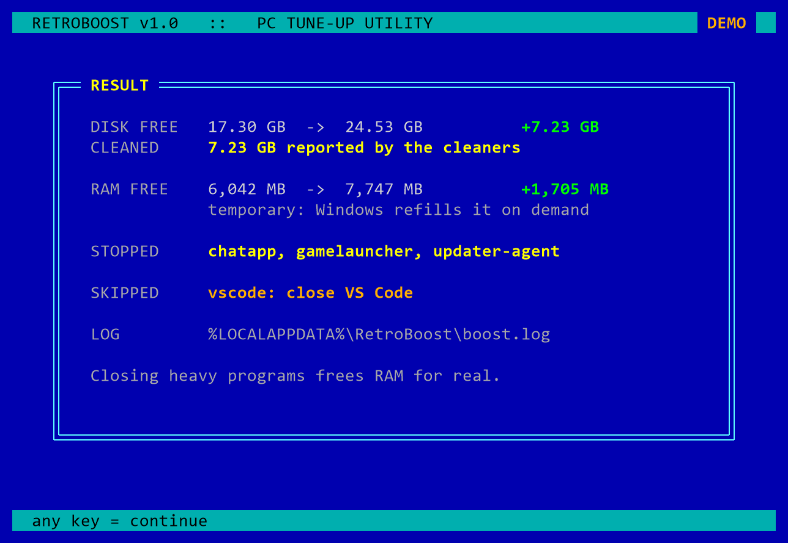
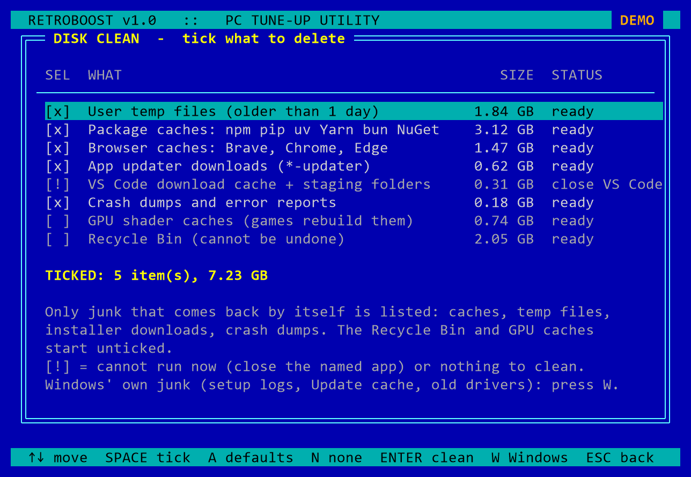
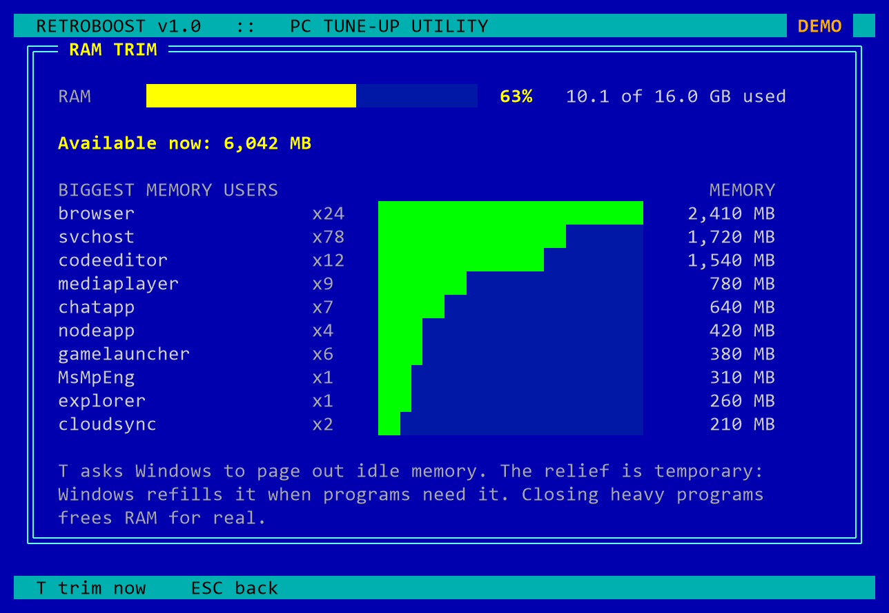
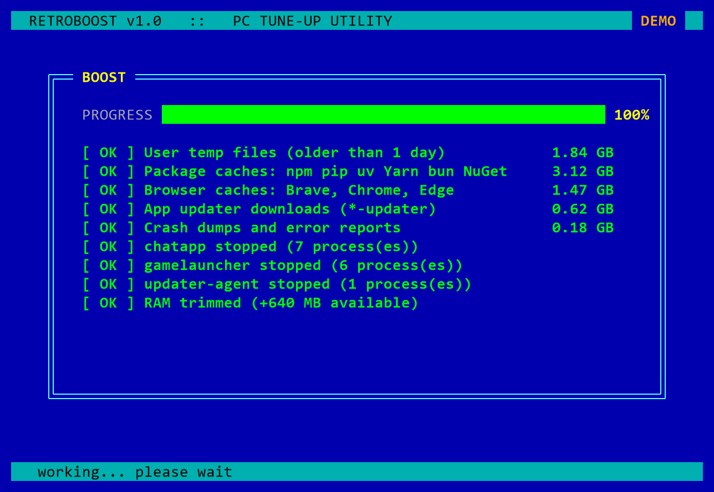

<div align="center">

# 🕹️ RetroBoost

### Free up your C: drive, trim RAM and stop unwanted programs — in one click.

A retro text-mode PC tune-up for Windows, written in PowerShell.<br>
**Free · open source · no install · no admin · no network · no telemetry**

[](LICENSE)
[](https://github.com/PowerShell/PowerShell)
[](#-quick-start)
[](https://github.com/DevDataAnalyst/RetroBoost/actions/workflows/ci.yml)
[](CONTRIBUTING.md)


<sub>Every screenshot in this README is rendered from the app's built-in <code>-Demo</code> mode (invented data, nothing from a real PC).</sub>

</div>

---

## Contents

[Why you'll want it](#-why-youll-want-it) ·
[Free up your C: drive: the plan](#-free-up-your-c-drive-the-plan) ·
[Quick start](#-quick-start) ·
[Screenshots](#-screenshots) ·
[What BOOST does](#-what-boost-does) ·
[Safety first](#-safety-first) ·
[Usage](#-usage) ·
[FAQ](#-faq) ·
[Contribute](#-contribute) ·
[Roadmap](#-roadmap) ·
[License](#-license)

## ✨ Why you'll want it

| | |
|---|---|
| 🧹 **Get gigabytes back, safely** | Cleans only junk that Windows and your apps rebuild by themselves: temp files older than a day, package and browser caches, installer downloads, crash dumps. Documents, photos and downloads are never touched. |
| 🧠 **Stop RAM hogs on your terms** | Build a *kill list* of programs you don't want running. BOOST closes them politely so they can save. Windows, security tools and your terminal are protected and can't be added. |
| 🖱️ **One click, or two keys** | `RetroBoost-OneClick.cmd` shows a 3-second countdown (ESC cancels), then runs BOOST. Prefer control? Open the app, read the plan, press ENTER. |
| 🔍 **Nothing hidden** | A plan screen before every action, a dry-run mode, a demo mode with invented data, and a log of everything it does. One readable script, no network calls, no telemetry. |
| 🪶 **Zero install, zero admin** | Download, double-click. It runs as you and touches only your own files. |
| 🕹️ **A UI that sparks joy** | Blue-screen DOS look, BIOS boot splash, block-letter logo, three phosphor themes (blue, green, amber) and optional beeps. |
| 👩‍💻 **Developer friendly** | Clears npm, pip, uv, Yarn, bun and NuGet caches, VS Code leftovers and crash dumps: the things that quietly eat a small SSD. |
| 🎓 **Made for small SSDs** | Students, travellers, 128–256 GB laptops: see where the space goes and get it back before Windows Update complains. |

**Honest about the limits.** RAM trimming gives *temporary* relief, because Windows refills memory when programs ask for it; closing heavy programs is what frees RAM for real, and RetroBoost says so on screen. Windows' own junk (Update cache, previous installations) is best removed by Windows itself, so RetroBoost opens the right Settings page for you (`W` on the Disk screen).

## 🧭 Free up your C: drive: the plan

C: almost full? Work through this list from the top. The first steps give the most space for the least risk. The full guide, with the *why* and the warnings, is in **[docs/FREE-UP-C-DRIVE.md](docs/FREE-UP-C-DRIVE.md)**.

| # | Step | Time | Typical gain | How |
|---|------|------|--------------|-----|
| 1 | **Measure** | 1 min | n/a | Open RetroBoost (the disk gauge turns red above 85%) or *Settings → System → Storage* |
| 2 | **Clear the safe junk** | 2 min | 0.5–10 GB | RetroBoost → **BOOST NOW** |
| 3 | **Let Windows clean itself** | 5 min | 1–25 GB | RetroBoost → *DISK CLEAN* → **W** (opens *Settings → Storage → Temporary files*) |
| 4 | **Uninstall what you don't use** | 5 min | 2–50+ GB | *Settings → Apps → Installed apps*, sorted by size |
| 5 | **Hunt big files** | 10 min | varies | File Explorer search `size:gigantic` inside Downloads, Videos, Desktop |
| 6 | **Move, don't delete** | 10 min | 5–100+ GB moved | OneDrive *Free up space*, game libraries and Downloads to another drive |
| 7 | **Keep it clean** | 2 min, once | prevents the next crunch | Turn on *Storage Sense*; run RetroBoost monthly |

Gains vary a lot from PC to PC; they are ranges, not promises. Developers get a bonus checklist (Docker, WSL, `node_modules`, SDKs) in the full guide.

## 🚀 Quick start

```text
1. Install PowerShell 7 (once):        winget install Microsoft.PowerShell
2. Download the latest release zip:    https://github.com/DevDataAnalyst/RetroBoost/releases/latest
   Right-click the zip → Properties → tick "Unblock" → Extract all
3. Double-click RetroBoost.cmd, press ENTER on BOOST NOW, press ENTER to confirm.
```

**Want a risk-free look first?** Open a terminal in the folder and run:

```text
RetroBoost.cmd -Demo
```

Demo mode uses invented data: nothing on your PC is read, changed or stopped.

**Prefer git?**

```text
git clone https://github.com/DevDataAnalyst/RetroBoost.git
cd RetroBoost
.\RetroBoost.cmd
```

### Requirements

- Windows 10 or 11
- [PowerShell 7+](https://github.com/PowerShell/PowerShell) (`pwsh`); Windows PowerShell 5.1 is not supported yet ([help wanted](docs/ROADMAP.md))
- A terminal window of at least **80×26** characters; [Windows Terminal](https://aka.ms/terminal) looks best

## 🖼️ Screenshots

<table>
  <tr>
    <td align="center"><br><sub><b>The plan screen</b>: nothing runs until you press ENTER</sub></td>
    <td align="center"><br><sub><b>The result</b>: before → after, and what was skipped and why</sub></td>
  </tr>
  <tr>
    <td align="center"><br><sub><b>DISK CLEAN</b>: tick what to delete, see the size first</sub></td>
    <td align="center"><br><sub><b>PROCESSES</b>: protected programs are locked (#), your kill list is starred (*)</sub></td>
  </tr>
  <tr>
    <td align="center"><br><sub><b>RAM TRIM</b>: see the biggest memory users</sub></td>
    <td align="center"><br><sub><b>BOOSTING</b>: DOS-style progress log</sub></td>
  </tr>
  <tr>
    <td align="center"><br><sub><b>Green phosphor</b> theme</sub></td>
    <td align="center"><br><sub><b>Amber phosphor</b> theme</sub></td>
  </tr>
</table>

### 📸 Real terminal captures: help wanted

The images above are painted from the app's own screen buffer by [`tools/Render-Screenshots.ps1`](tools/Render-Screenshots.ps1). We would love **real captures** from real terminals, fonts and themes. Drop a PNG into `docs/screenshots/` (see [how](docs/screenshots/README.md)) and send a pull request; your name goes in the credits.

| Windows Terminal | Classic console host | Your setup |
|:---:|:---:|:---:|
| <!-- add docs/screenshots/real-windows-terminal.png --> *your screenshot here* | <!-- add docs/screenshots/real-console-host.png --> *your screenshot here* | <!-- add docs/screenshots/real-yours.png --> *your screenshot here* |
| **Boot splash (animated)** | **One-click countdown** | **Demo mode tour (GIF)** |
| <!-- add docs/screenshots/boot-splash.gif --> *a short GIF would be perfect* | <!-- add docs/screenshots/one-click.png --> *your screenshot here* | <!-- add docs/screenshots/demo-tour.gif --> *your GIF here* |

## 🧰 What BOOST does

BOOST = **clean junk** + **trim RAM** + **close your kill-list programs**. The kill list starts **empty**, so a fresh install stops nothing until *you* add programs.

| Category | Where (for your user account) | Rule |
|---|---|---|
| User temp files | `%TEMP%` | only files older than 1 day; the `claude` temp folder is skipped |
| Package caches | `%LOCALAPPDATA%\npm-cache`, `uv\cache`, `pip\cache`, `Yarn\Cache`, `NuGet\v3-cache`, `%USERPROFILE%\.bun\install\cache` | they regrow on demand |
| Browser caches | Brave, Chrome and Edge `User Data\*\Cache`, `Code Cache`, `GPUCache` | skipped while that browser is open; logins and history stay |
| Updater downloads | `%LOCALAPPDATA%\*-updater` | installer copies apps fetch again if needed |
| VS Code leftovers | `%APPDATA%\Code\CachedExtensionVSIXs`, hidden staging folders in `.vscode\extensions` | skipped while VS Code is open |
| Crash dumps and reports | `%LOCALAPPDATA%\CrashDumps`, `Microsoft\Windows\WER` | diagnostic leftovers |
| GPU shader caches | `D3DSCache`, `NVIDIA\DXCache`, `NVIDIA\GLCache`, `AMD\DxCache` | **unticked**: games rebuild them once |
| Recycle Bin | C: | **unticked**: emptying cannot be undone |

Details and the reasoning behind each rule: **[docs/SAFETY.md](docs/SAFETY.md)**.

## 🛡️ Safety first

RetroBoost deletes files and stops programs, so it is built to be boring and predictable.

- **Plan before action.** BOOST, DISK CLEAN and STOP all show what will happen and wait for ENTER. (You can turn the confirmation off in Settings if you want a true one-keypress BOOST.)
- **Protected programs.** Windows core processes, security tools, the terminal and anything it cannot read are locked (`#`) and can never be stopped from here.
- **Polite close first.** Programs with a window are asked to close so they can offer to save. `F` (force) is explicit and warns about unsaved work.
- **Dry-run and demo.** `-DryRun` changes nothing; `-Demo` doesn't even read your PC.
- **A log.** Everything it does is written to `%LOCALAPPDATA%\RetroBoost\boost.log`.
- **A self-test.** [`tests/selftest.ps1`](tests/selftest.ps1) builds a throwaway sandbox with fake caches and a fake "unwanted" program, then proves that dry-run changes nothing and a real BOOST removes exactly the right things. CI runs it on every change.

> ⚠️ **Use at your own risk.** Deleted files do not go to the Recycle Bin. Try `-Demo` and `-DryRun` first and read the plan screen. See the [MIT license](LICENSE) (no warranty).

## ⌨️ Usage

```text
RetroBoost.cmd                    open the app
RetroBoost.cmd -Boost             open straight on the BOOST plan
RetroBoost-OneClick.cmd           one click: 3-second countdown (ESC cancels), then BOOST
RetroBoost.cmd -DryRun            show everything, change nothing
RetroBoost.cmd -Demo              a tour with invented data
```

| Option | Meaning |
|---|---|
| `-Boost` | open on the BOOST plan |
| `-Boost -Yes` | one-click mode: countdown instead of the plan screen, closes after the result |
| `-DryRun` | nothing is deleted, trimmed or stopped; the screens show what *would* happen |
| `-Demo` | invented data; nothing real is read, changed or stopped; no log, no settings written |
| `-Theme blue\|green\|amber` | theme for this run (change it permanently in Settings) |
| `-ConfigDir <path>` | where settings and the log live (default `%LOCALAPPDATA%\RetroBoost`) |

| Key | Where | Action |
|---|---|---|
| `↑ ↓` `ENTER` `ESC` | everywhere | move, select, go back |
| `B` `D` `R` `P` `S` `Q` | main menu | BOOST, Disk, RAM, Processes, Settings, Quit |
| `SPACE` `A` `N` `W` | Disk | tick, defaults, none, open Windows Storage settings |
| `T` | RAM | trim now |
| `SPACE` `K` `X` `F` `S` | Processes | mark, add to kill list, stop, force stop, sort |
| `F1` | main menu | help |
| `Ctrl+C` | anywhere | quit |

Contributors: the test hooks (`-Sandbox`, `-Keys`, `-Screenshot`, `-Dump`) are explained in [docs/ARCHITECTURE.md](docs/ARCHITECTURE.md).

## ❓ FAQ

<details>
<summary><b>Will it delete my files?</b></summary>

Only the categories listed above, which are caches and leftovers that come back by themselves. Your documents, pictures, downloads and desktop are never touched. The Recycle Bin option is unticked by default.
</details>

<details>
<summary><b>Does it need administrator rights?</b></summary>

No, and it never asks for them. It only cleans your own user folders. For Windows' own junk (Update cache, previous installations) it opens *Settings → System → Storage* so Windows can do it.
</details>

<details>
<summary><b>Does "RAM TRIM" make my PC faster?</b></summary>

It asks Windows to move idle memory out of programs' working sets, which shows up as more *available* memory right away. Windows refills it when programs need it, so treat it as a short-lived boost. Closing heavy programs (see the PROCESSES screen) is what lasts.
</details>

<details>
<summary><b>Why was "Browser caches" skipped?</b></summary>

The browser was open, and clearing a cache under a running browser is a bad idea. Close it and run again. The result screen tells you which category was skipped and why.
</details>

<details>
<summary><b>Windows SmartScreen or my antivirus complains.</b></summary>

RetroBoost is an unsigned script that deletes files, so cautious tools may flag it. Right-click the downloaded zip → Properties → *Unblock*, read [`src/retroboost.ps1`](src/retroboost.ps1) (it is one file), and run `-Demo` first. Code signing for releases is on the [roadmap](docs/ROADMAP.md).
</details>

<details>
<summary><b>Where are my settings and the log? How do I uninstall?</b></summary>

Both live in `%LOCALAPPDATA%\RetroBoost`. To uninstall, delete the RetroBoost folder and that settings folder.
</details>

<details>
<summary><b>Does it work on Windows 10? On a laptop? On a school or work PC?</b></summary>

Windows 10 and 11, desktop or laptop, as long as you can run PowerShell 7. Managed PCs may block scripts or restrict process control; follow your organisation's policy.
</details>

## 🤝 Contribute

**RetroBoost is a community project in the making, and we want developers from all over the world to help make it more powerful.** You don't need to be a PowerShell wizard.

- 🧹 **Add a cleanup category**: you know where some app hides its cache? Add it, with a sandbox test. ([how](CONTRIBUTING.md#add-a-cleanup-category))
- 🧠 **Teach it about processes**: smarter protection, per-process CPU, a startup-programs screen.
- 🎨 **Make it prettier**: new themes, an ASCII fallback for old consoles, mouse support, animations.
- 🌍 **Translate it**: the UI text is ready to be moved into language files.
- 🧪 **Test it** on your Windows build, terminal and font, and tell us what broke.
- 📸 **Capture it**: real screenshots and GIFs (the placeholders above are waiting).
- 📝 **Improve the docs**: especially the [C: drive plan](docs/FREE-UP-C-DRIVE.md).

Start here: **[CONTRIBUTING.md](CONTRIBUTING.md)** · ideas and difficulty levels: **[docs/ROADMAP.md](docs/ROADMAP.md)** · how the code works: **[docs/ARCHITECTURE.md](docs/ARCHITECTURE.md)**.
Found a bug, especially one where RetroBoost touched something it shouldn't? **[Open an issue](https://github.com/DevDataAnalyst/RetroBoost/issues/new/choose)**; those get top priority.

## 🗺️ Roadmap

Next up (the full list, with good-first-issue ideas, is in [docs/ROADMAP.md](docs/ROADMAP.md)):

- [ ] Configurable protected-programs list and temp-skip folders
- [ ] More categories: other browsers, chat apps, Gradle/Maven, Docker/WSL guidance
- [ ] Startup-programs screen (list, disable, undo)
- [ ] Big-files explorer: where did my space go?
- [ ] Optional admin mode for Windows Update cache and logs, with strong guardrails
- [ ] ASCII mode, translations, mouse support
- [ ] winget / Scoop packages and signed releases

## 📄 License

[MIT](LICENSE) © 2026 DevDataAnalyst and RetroBoost contributors.

RetroBoost is not affiliated with Microsoft or any other company mentioned. Product names belong to their owners. The boot-splash copyright line is a joke.

<div align="center"><sub>Made with ☕, nostalgia and a lot of free space.</sub></div>
